# GitHub Readme Stats Fast Action（简体中文）

[English](Readme.md) | **简体中文**

使用 GitHub Actions 自动生成 [GitHub Readme Stats Fast](https://github.com/pranesh-2005/github-readme-stats-fast) 的 SVG 卡片，将生成的文件提交到你的仓库，并在 GitHub 个人主页 README 中展示。无需自行部署服务器。

## 功能特点

- 支持生成六种卡片：`stats`（统计）、`top-langs`（常用语言）、`streak`（连续贡献）、`pin`（置顶仓库）、`wakatime`（编码时长）和 `gist`。
- 可通过查询字符串或 JSON 配置卡片选项。
- 可以自定义 SVG 文件的输出路径。
- 可将生成的 SVG 文件直接嵌入 GitHub README。
- 支持定时执行，也支持在 Actions 页面手动运行。

## 快速开始

以下示例适用于你的**个人主页仓库**，即仓库名称与你的 GitHub 用户名相同的仓库。它会生成三张卡片，并把 SVG 文件提交回仓库。

创建文件 `.github/workflows/readme-stats.yml`：

```yaml
name: Update README cards

on:
  schedule:
    - cron: "0 0 * * *"
  workflow_dispatch:

permissions:
  contents: write

jobs:
  build:
    runs-on: ubuntu-latest
    steps:
      - name: Check out repository
        uses: actions/checkout@v5

      - name: Generate stats card
        uses: zb479519891/github-readme-stats-fast-action@main
        with:
          card: stats
          options: username=${{ github.repository_owner }}&show_icons=true
          path: profile/stats.svg
          token: ${{ secrets.GITHUB_TOKEN }}

      - name: Generate top languages card
        uses: zb479519891/github-readme-stats-fast-action@main
        with:
          card: top-langs
          options: username=${{ github.repository_owner }}&layout=compact&langs_count=6
          path: profile/top-langs.svg
          token: ${{ secrets.GITHUB_TOKEN }}

      - name: Generate streak card
        uses: zb479519891/github-readme-stats-fast-action@main
        with:
          card: streak
          options: username=${{ github.repository_owner }}&layout=compact
          path: profile/streak.svg
          token: ${{ secrets.GITHUB_TOKEN }}

      - name: Commit generated cards
        run: |
          git config user.name "github-actions[bot]"
          git config user.email "41898282+github-actions[bot]@users.noreply.github.com"
          git add profile/*.svg
          git diff --cached --quiet && exit 0
          git commit -m "Update README cards"
          git push
```

**注意：**

- `permissions: contents: write` 是将生成的 SVG 文件提交回仓库所必需的权限。
- 如果工作流无法写入仓库，请在仓库的 **Settings → Actions → General → Workflow permissions** 中检查是否允许读写权限。
- 上面的定时任务使用 UTC 时间。你也可以删除 `schedule`，只保留 `workflow_dispatch`，然后手动触发工作流。

## 在 README 中显示卡片

在个人主页仓库的 `README.md` 中添加以下内容。图片语法开头的 `!` 不可省略，否则只会显示文字链接，而不是图片。

```md



```

如果希望点击图片后打开 SVG 文件，可以将图片嵌套在链接中：

```md
[](./profile/top-langs.svg)
```

## 输入参数

| 参数 | 必填 | 说明 |
| --- | --- | --- |
| `card` | 是 | 卡片类型：`stats`、`top-langs`、`streak`、`pin`、`wakatime` 或 `gist`。 |
| `options` | 否 | 卡片选项。支持查询字符串（`key=value&...`）或 JSON，默认值为空。 |
| `path` | 否 | 生成的 SVG 文件路径，默认是 `profile/<card>.svg`。 |
| `token` | 否 | 传递给渲染器的 GitHub Token，默认值为空。 |

Action 还会输出名为 `path` 的值，表示生成的 SVG 文件路径。

## 使用示例

### 1. 统计卡片（stats）

```yaml
- name: Generate stats
  uses: zb479519891/github-readme-stats-fast-action@main
  with:
    card: stats
    options: username=octocat&show_icons=true&hide_rank=true&bg_color=0D1117
    path: profile/stats.svg
    token: ${{ secrets.GITHUB_TOKEN }}
```

### 2. 最常用语言卡片（top-langs）

```yaml
- name: Generate top languages
  uses: zb479519891/github-readme-stats-fast-action@main
  with:
    card: top-langs
    options: username=octocat&layout=compact&langs_count=6
    path: profile/top-langs.svg
    token: ${{ secrets.GITHUB_TOKEN }}
```

### 3. 连续贡献卡片（streak）

```yaml
- name: Generate streak
  uses: zb479519891/github-readme-stats-fast-action@main
  with:
    card: streak
    options: username=octocat&layout=compact
    path: profile/streak.svg
    token: ${{ secrets.GITHUB_TOKEN }}
```

### 4. 置顶仓库卡片（pin）

将 `repo` 替换成你想展示的仓库名称。

```yaml
- name: Generate pinned repository card
  uses: zb479519891/github-readme-stats-fast-action@main
  with:
    card: pin
    options: username=octocat&repo=Hello-World
    path: profile/pin-hello-world.svg
    token: ${{ secrets.GITHUB_TOKEN }}
```

### 5. WakaTime 编码时长卡片（wakatime）

```yaml
- name: Generate WakaTime card
  uses: zb479519891/github-readme-stats-fast-action@main
  with:
    card: wakatime
    options: username=octocat&layout=compact
    path: profile/wakatime.svg
    token: ${{ secrets.GITHUB_TOKEN }}
```

### 6. Gist 卡片（gist）

将示例中的 ID 替换为你要展示的 Gist ID。

```yaml
- name: Generate gist card
  uses: zb479519891/github-readme-stats-fast-action@main
  with:
    card: gist
    options: id=0123456789abcdef
    path: profile/gist.svg
    token: ${{ secrets.GITHUB_TOKEN }}
```

### 使用 JSON 配置选项

如果需要使用 JSON，请用单引号包裹整个 JSON 对象：

```yaml
- name: Generate stats with JSON options
  uses: zb479519891/github-readme-stats-fast-action@main
  with:
    card: stats
    options: '{"username":"octocat","show_icons":true,"hide_rank":true}'
    path: profile/stats.svg
    token: ${{ secrets.GITHUB_TOKEN }}
```

## Token 与权限

- 对于公开仓库卡片，可以先尝试使用 `${{ secrets.GITHUB_TOKEN }}`。
- 某些卡片或私有数据场景可能需要具有相应权限的个人访问令牌（PAT）。请将令牌保存为仓库 Secret，再通过 `token` 参数传入。
- **不要**将 Token 直接写进工作流文件或 README。
- 只有在需要将生成的 SVG 文件提交回仓库时，工作流才需要 `contents: write` 权限。
- 如果工作流运行失败，请打开仓库的 **Actions** 页面，查看失败步骤的日志。

## 工作原理

1. GitHub Actions 检出你的仓库。
2. Action 运行所选卡片的渲染器，并将 SVG 写入 `path` 指定的位置。
3. 工作流将生成的 SVG 文件提交回仓库。
4. README 引用这些文件并将它们作为图片显示。

本 Action 使用 [Pranesh-2005/github-readme-stats-fast](https://github.com/pranesh-2005/github-readme-stats-fast) 提供的渲染器和数据获取逻辑。其他部署方式请参考上游项目的[部署文档](https://github.com/pranesh-2005/github-readme-stats-fast#deploy-on-your-own)。

## 许可证

本项目采用 [MIT License（MIT 许可证）](LICENSE)。
